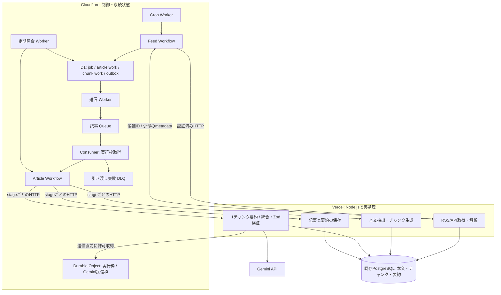

# Cloudflare 管理 + Vercel 実行によるバッチ移行計画

更新日: 2026-10-10。ステータス: 提案。稼働環境・実クォータには未接続。ユーザー指定の責務分担と Terraform 管理を反映した改訂案。

## 要件と推奨構成

- Cron、実行状態、記事とチャンクの進捗、キュー、再試行、並列数、Gemini の送信制御は Cloudflare に置く。
- RSS/API 解析、HTML 本文抽出、チャンクの生成、Gemini 呼び出し、要約の検証、PostgreSQL 保存は Vercel の Node.js Functions で実行する。
- インフラリソースと設定は Terraform 管理にする。既存 `infra/`、R2 remote state、Terraform CI を拡張する。
- 無料枠を優先する。Cloudflare Containers、Vercel Cron、Vercel Workflows は今回の構成に含めない。
- 記事データは既存 PostgreSQL / Drizzle を維持し、Web は現在の構成を維持する。

Cloudflare は Vercel の処理完了を HTTP で待ち、返された少量の参照 ID を step の戻り値として記録する。Cloudflare で本文を解析したり大量の JSON を加工したりしない。Vercel は1回の呼び出しで1段階を処理し、Cloudflare が次の段階を決める。

## 責務とデータの境界

| 対象 | 管理・実行場所 | 方針 |
| --- | --- | --- |
| 定期起動・手動起動 | Cloudflare Worker / Cron | Terraform の cron 設定を唯一の管理元にする |
| 処理順序・待機・再試行 | Cloudflare Workflows | HTTP失敗・429・チャンク再開の判断を担当 |
| 記事の投入待ち・再配送・DLQ | Cloudflare Queues | consumer は Workflow への引き渡しまで |
| 長期の制御状態・チャンク進捗 | Cloudflare D1 | job/work ID、status、attempt、lease、次回時刻、参照 ID、error code |
| 実行枠・Geminiの送信枠 | Cloudflare Durable Objects（SQLite） | 全run・全Vercel invocationで共有 |
| RSS解析、本文抽出、チャンク生成 | Vercel Node.js Functions | 現行 parser、jsdom、Readability を再利用して検証 |
| チャンク要約・統合・出力検証 | Vercel Node.js Functions | Gemini SDK、Zod。1呼び出しは1チャンクか1統合 |
| 本文・チャンク本文・生成結果・最終記事 | 既存 PostgreSQL | Vercelから保存。D1には大きい本文を置かない |
| 永続保存の重複防止 | PostgreSQL | stable operation ID、unique制約、transaction |
| リソース・bindings・スケジュール | Terraform | staging / production を分離、既存Web資源を保持 |

D1 は制御状態専用として追加する。商品データの PostgreSQL を D1 へ移行する案ではない。チャンクの分割計算は Vercel が行うが、どのチャンクを次に実行するか、完了・失敗・再試行の状態は Cloudflare が管理する。

Cloudflare は通常 PostgreSQL へ直接接続しないため、今回のバッチに Hyperdrive は不要。既存 `crawl_jobs` は互換性のため維持し、D1の業務状態からVercelの保存APIを通じて必要な集計を反映する。正の制御状態を二箇所で独立に更新しない。

## 実行フロー

1. Cron が feed 単位の安定した run key を使って Feed Workflow を起動する。scheduled time と feed ID の重複を D1 unique 制約で除く。
2. Feed Workflow が Vercel の discovery API を呼ぶ。RSS/XML の取得・解析・URL正規化・既存記事判定はVercelで行い、候補をPostgreSQLに保存する。返却は候補ID・処理version・ページ情報のみとし、候補数とレスポンスサイズを制限する。
3. 候補の work と送信予定 outbox を D1 の原子的なbatchで記録する。送信WorkerがQueueへ投入し、成功後に送信済みを記録する。途中中断による重複送信を許容し、Queue投入漏れは再送する。
4. consumer は期限付きの実行枠を取得し、stable Workflow IDでArticle Workflowを作成する。作成済み実行を確認できた後にack。枠不足は遅延再配送し、引き渡しに失敗し続けたものはDLQへ送る。
5. Article Workflow がVercelの抽出APIを呼ぶ。Vercelは本文抽出と分割を実行し、本文・チャンクをPostgreSQLへ保存する。返却するmanifestは参照IDと件数だけ。多数のチャンクはページ単位でD1へ登録する。
6. Cloudflareが未完了チャンクを選び、Vercelの要約APIを呼ぶ。Vercelは送信直前にCloudflareのgate APIで許可を取得する。枠不足ならGeminiを呼ばず短い待機情報を返す。Cloudflareが `step.sleep` 後に再実行する。
7. 要約結果はVercelでPostgreSQLへ保存し、成功結果IDをCloudflareに返す。Workflowがチャンクの完了をD1へ記録する。全チャンク完了後に統合・検証APIを呼ぶ。
8. 最終保存APIが記事・本文・要約・metrics・operation完了を1 transactionで確定する。Cloudflareは記事workを完了し、全件terminalならfeed jobを集計する。
9. 定期照合がD1とWorkflowの状態、必要時はVercelのoperation照会APIを確認して、残ったrunning、未送信outbox、期限切れleaseを回復する。

### APIの契約案

実装は `apps/collector` 配下に置く独立した Vercel project を第一案とする。Web の実装・デプロイと混ぜない。URL は例であり、handler の配置はVercel build PoCで確定する。

| API | 実行すること | 返却すること |
| --- | --- | --- |
| `POST /api/discover` | 1 feed・1ページを取得・解析、候補を保存 | 候補ID、次ページ、件数 |
| `POST /api/extract` | 1記事の本文抽出と分割、payloadを保存 | content ID、chunk manifest の参照 |
| `POST /api/summarize-chunk` | 指定された1チャンクをGeminiへ送信・保存 | result ID / retry-after / terminal error |
| `POST /api/merge-summary` | 保存済みチャンクから統合しZodで検証・保存 | final result ID / retry-after |
| `POST /api/persist` | final resultを記事・要約・metricsへ原子的に反映 | article ID、operation完了 |
| `POST /api/operation-status` | 安定したoperation IDで保存済み結果を照会 | 実行中 / 完了 / 結果ID |

APIは同期応答を第一案とする。「202を返して裏で処理し続ける」方式は採用しない。Vercelのレスポンス後に処理継続する仕組みやメモリを、永続キュー・進捗の代替にしない。

## 二重実行、状態整合性、認証

### 保存と再開

- operation key は article ID、stage、chunk index、input hash、prompt/model version から決める。retry attempt をoperation keyに含めず、再配送時は同じ結果を再利用する。
- Vercelのoperation tableで処理権をatomic claimする。各invocationは開始時に完了結果を確認し、Cloudflare→VercelのHTTP応答が失われても保存済み結果を返せるようにする。
- D1 と PostgreSQL の間に分散transactionはない。Vercelの結果保存 → Cloudflareの進捗確定の順にし、保存成功後の通知失敗はoperation照会と定期照合で回復する。
- Geminiで生成が完了しても応答を失った場合など、LLM課金の完全な一回保証はできない。保存済みチャンクの再利用とbounded retryで余分な生成を減らす。
- leaseは所有者tokenと有効期限を持つ。HTTP timeout後もVercel側が動いている可能性を考慮し、operation照会、期限、fencing条件により即座の二重起動を防ぐ。CF実行枠とVerceloperation lockの双方を照合する。
- 現行 `saveArticle()` は複数テーブルへ別々に書き込み、先に要約済み状態になる。transaction化し、失敗更新が他の成功状態を上書きしない条件を追加する。

### Gemini送信制御

現行コードは1要約器・1プロセス内の60秒移動窓によるRPM制御（既定5）と、429時の限定retry（追加既定2回）を実装している。通常要約、チャンク、統合、fallback、retryは同じ送信関数を通る。Triggerのバッチ同時実行は1だが、複数Vercel invocationの共有状態やTPM/RPDは未実装。既存の狭いVitestは2ファイル・11テスト成功し、実API・分散ゲートは未検証である。[送信制御の図解](gemini-rate-limit-flow.html)に実装状況とフローを記載する。

- 送信量はCloudflareのDOが管理し、実際のAPI呼び出しはVercelが担当する。Google projectとモデル別のRPM・入力TPM・RPDの制御を実装要件にする。さらに保守的なproject全体の枠と費用上限を設定する。Google側の実クォータはAI Studioで確認して環境設定へ反映する。
- DOはproject単位でモデル別の予算も保持し、同時permit要求に対して判定とRPM/TPM/RPD予約を原子的に確定する。再起動後も予約、cooldown、日次カウントをSQLiteから復旧する。
- promptを含む入力tokenをVercelで見積もり、安全余裕を持ってTPMを予約する。usage metadataと照合し、見積もり誤差を観測する。1入力が枠そのものより大きい場合は分割・縮小し、単にretryし続けない。TPM枠不足は次の枠の解放まで待機する。
- RPD残量がなければ日次リセットまで保留する。日次境界は `America/Los_Angeles` の0時で夏時間を含めて扱い、短いbackoffによる無限retryを避ける。同じGoogle projectのstaging、production、他アプリの利用もgateへ集約するか予算から差し引く。
- Workflow開始時に取得した許可を、後で再利用しない。各API送信直前にVercelから認証済みgate APIを呼ぶ。
- gateはpermit ID・有効期限・待機時間を返す。許可の発行と実送信は別サービス間になるため、厳密な同時刻保証を仮定しない。短い許可期限と保守的な送信間隔でネットワーク遅延を見込み、期限を過ぎた許可では送信しない。遅延・時計差・再試行のケースをPoCで検証する。
- 枠不足や429でVercel内に長いsleepを置かない。Cloudflareへretry-afterを返してWorkflowが待機する。チャンク、統合、fallback、再試行はすべて同じgateを通す。
- 枠不足でGeminiを呼んでいない待機はAPI attemptと区別する。operationをwaitingへ遷移させ、次のstage invocationが安全に処理権を再取得できるようにする。permit予約と実際の送信数も区別し、未送信予約を安易に返却しない。
- 429を受けたら、取得可能なRetry-After / retry情報またはbounded backoff+jitterを使い、対象quotaの共有cooldownへ反映する。その他のinvocationが直後に送り続けることを防ぐ。追加retryは初期案2回とし、attempt上限に達したら当該stageを失敗として記録・通知する。
- SDK内部とWorkflowの二重retryを避ける。SDKの挙動を検証し、最終的なattempt上限はCloudflare側で管理する。

ローカルの予算制御で429を完全に防ぐとは主張しない。Google側の容量変動、モデルごとの実quota、token見積もり誤差、gateを通らない外部利用、ネットワーク遅延があるため、予防制御と429回復の双方を必要とする。HTMLの13秒間隔・TPM数値は理解のための仮定で、本番設定ではない。

### 呼び出し認証

- Cloudflare→Vercel、Vercel→Cloudflareの双方で認証する。method、path、body hash、environment、issued/expiry time、request IDを署名し、本文を検証してから処理する。
- 論理operation IDはretryで保持し、署名nonceは各HTTP attemptで新規にする。実行の重複排除とリクエストのreplay防止を区別する。環境別のsecretと参照IDを使う。
- 必要ならVercel Deployment Protectionのautomation bypassをheaderで付ける。ただしbypassはアプリの認証・認可を置き換えない。query stringにsecretを置かない。
- executor URLはallowlistされたHTTPS originに固定する。任意URL、任意prompt、任意DB操作を外部から指定できるAPIにしない。
- work開始時にexecutorのdeployment URLとAPI versionを固定する。production aliasがdeployで切り替わっても途中チャンクの実装が混ざらないようにし、参照中の旧deploymentはdrain完了まで保持する。古いAPI versionへの再開と署名認証をstagingで確認する。
- VercelはGemini keyとPostgreSQL接続情報を持ち、Cloudflareは通信認証のsecretを持つ。本文・生応答・secretはlogsへ残さず、job/work/operation IDで追跡する。

## Terraform管理要件

既存 `infra/environments/production` はCloudflare provider 5.24.0とVercel provider 5.14.0をlockしている。latestのドキュメントにある属性が現行lockで利用できるとは限らない。PoCでprovider schemaと必要resourceの実動を確認し、必要なupgradeだけを独立したplanでレビューする。

| リソース・設定 | 管理方法の候補 |
| --- | --- |
| collector用Vercel project、Git連携、Node/build設定、domain | `vercel_project`、`vercel_project_domain`。既存Web moduleを無条件で変更せず別moduleを追加 |
| Worker、bindings、compatibility、DO SQLite class/migrations、observability | `cloudflare_workers_script`。bundleをCIで作り、Terraformからupload。version/deployment資源を使う場合は同じ資源の二重管理を避ける |
| Cron | `cloudflare_workers_cron_trigger`。Workflow scheduleと重複登録しない |
| Feed / Article Workflow定義 | `cloudflare_workflow`。instance/進捗はruntime管理 |
| Queue / DLQ / consumer / retry / concurrency | `cloudflare_queue`、`cloudflare_queue_consumer` |
| 制御状態用D1 databaseとbindings | `cloudflare_d1_database`。table schema/data migrationはversion付きCIジョブ |
| DNS / Vercel domain | 既存moduleを拡張し、WebのDNSを保持 |
| Terraform state | 既存R2 S3 backendを維持。batch用state keyを分離しstagingを追加。外部repo管理のstate bucketを再作成しない |

Terraformはresourceの作成・設定・変更・削除を管理する。VercelのアプリコードはCIでdeployし、D1/DOの業務データ、Workflow instance、DB migrationをTerraform resourceとして管理しない。WorkerのコードをTerraformでdeployする場合、Wranglerはbundle作成・ローカル検証に限定し、同じbindings、Cron、Workflow、Queueを別経路で変更しない。

runtime secretの値は既存方針に従ってTerraform stateへ保存しない。Cloudflare/Vercelのsecret storeへCIから注入し、Terraformはsecretの参照・保持設定を管理する。DO/Worker secretの保持とbindingの再適用が両立するか、固定provider versionで検証する。Terraformの `sensitive` 指定だけではstateから値は消えない。

Queue consumerはlatest provider docsでimport非対応とされているため、既存consumerの単純importを前提にしない。今回は新規batch資源を作成する。Worker/Workflowの初回作成順序、DO migrations、secret注入順序をPoCで確認し、bootstrapと通常deployの手順を区別する。

CIは `fmt → init -backend=false → validate → plan → reviewed apply` とする。現行 `release-infra` とenvironment承認、R2 lock、concurrencyを継承する。コード変更だけでもWorker bundleの変更がTerraformに反映される経路を用意する。runtimeの初回deploy、schema migration、secrets、認証疎通の成功後にだけCronを有効にする。

D1、DOを含むWorkerなど永続状態を持つ資源は削除保護・backup・restore手順を設ける。releaseによるWorkflow classのrenameやnamespaceの再作成を避ける。Terraform applyで既存Web、DNS、R2 backendを変更しないことをplanで確認する。

## 無料枠と実行制限

この分担はCloudflareでHTML/XML解析やGemini SDK処理を行う必要をなくすため、無料枠を狙う上で合理的。ただし無料で安定稼働できることを保証するものではない。

| 対象 | 主な無料制限 | 設計への反映 |
| --- | --- | --- |
| Cloudflare Workflows | CPU 10ms/step、3,000 steps/日、完了状態保持3日 | 小さいHTTP結果と参照IDのみ扱う。長期履歴はD1。制御処理自体のCPUも実測 |
| Queues | 10,000 operations/日、保持24時間 | 投入件数・再配送・バックログ監視。D1 outbox/workから回復 |
| Durable Objects | SQLite backend、request/duration/SQLの枠 | Gemini応答をDOで待たず、小さいpermitと枠管理のみ |
| D1 | 読取500万行/日、書込10万行/日、合計5GB | indexes、bounded queries、完了workの保持期限、本文を保存しない |
| Vercel Hobby | Node Function最大300秒、月4 CPU時間、360 GB時間等 | 1呼び出し1段階、request deadlineを上限より短くする。全runのusageを計測 |

Vercel側は初期案としてhandler全体の内部deadlineを240秒、Cloudflare側のHTTP待機とWorkflow timeoutをそれより長く設け、Vercelの300秒上限より余裕を持たせる。具体値は実測で調整する。外部fetch/SDKにはAbortSignalまたは対応するtimeoutを渡す。1 invocationで全記事・全チャンクを処理しない。

無料Workflowの外部subrequest制限も確認し、チャンク数、permit待ちによる再呼び出し、stage再試行の合計を予算に含める。長い記事や繰り返し待機で上限を超える場合は、チャンクwork単位の子Workflowへの分離もPoCで比較する。単にCPU処理を外へ移すだけで他の無料制限も解消したとは扱わない。

Cloudflareが定期起動するため、Vercel Hobby Cronの1日1回制限は今回の起動頻度を制限しない。Vercel Hobbyは非商用の個人利用向けという条件が残る。商用運用ならプランを再検討する。両サービスの無料枠は同じaccount内の他用途と共有されることを考慮し、Gemini/DBの費用は別に見積もる。

初期は1日100新規記事程度、処理中記事4、feed並列3を仮の上限にしてPoCを行う。記事あたり10 stepsなら記事分だけで1,000 steps/日。取得、gate待ち、統合、照合、再実行を加算して予算を確認する。小さいCPU処理でもstep数やVercel稼働量が多ければ枠を超える。

## 実装順序と検証

| 段階 | 内容 | 完了条件 |
| --- | --- | --- |
| 0. Hybrid PoC | Vercel Nodeビルド、CFから認証済みHTTP、5分制限、gate、D1、Terraform provider/schema/bootstrap | jsdom/SDKの実行、small control responseのCPU、再試行・timeout・secret保持・no-driftを確認 |
| 1. DBと契約 | operation/本文/チャンクpayload、transaction、claim、Zod API契約 | 同時実行・途中失敗・応答喪失で状態が壊れない |
| 2. 実行基盤 | CF Cron / D1 / Queue / Workflow / DO、Vercel stage API、Terraform modules / CI | 状態をCloudflareで管理し、1チャンクから再開できる |
| 3. staging | 別DBと別D1・Queue・DO・認証key、代表記事、長文、429、再配送、Vercel redeploy | 品質、成功率、p95、CPU、steps、Vercel usage、認証を合格基準で確認 |
| 4. 切替 | Trigger schedule停止、旧run終了確認、少数実行、新Cron有効化 | 片方のみ稼働。複数予定実行と回復・切り戻しを確認 |

工数は改訂案として10〜18作業日＋観察期間を暫定目安にする。二サービス間の認証・整合性、D1、Terraformのbootstrapが増えるため、初回PoCの結果で見積もり直す。

TDDで先に検証するケースは、署名不正/期限切れ/replay/環境混同、候補・chunk manifestのサイズ上限、並行operation claim、保存rollback、HTTP timeout後の遅延成功、応答喪失後の保存結果再利用、D1更新失敗の回復、重複Queueとoutbox再送、複数Vercel invocationの共有gate、期限切れpermit、429・日次上限、Vercel 300秒上限、Workflow再開・deploy version、切り戻しdrain。

### 変更対象案

- `apps/collector/src/`: feed/article処理を分離。`cloudflare/`には薄い制御adapters、`vercel/`には薄いNode handler。Vercelの入口はcollector project内でbuild PoCに従って配置する。
- `apps/collector/src/content.ts`、`summarizer.ts`、`persistence.ts`、`config.ts`: stage化、shared gate、deadline、operation ID、transaction。既存Trigger入口は移行完了まで保持。
- `packages/domain`: version付きstage request/responseのZod schema、共有ID/状態validation。
- `packages/db`: PostgreSQL staging payload/operation tableのadditive migration。`control-plane/`にD1 schema、migration、queriesを分離して置く。
- `infra/modules/cloudflare-collector/`、`infra/modules/vercel-collector/`、batch用environment/state、既存Terraform CI: 新規資源と環境分離を追加する。
- `docs/adr/0008-cloudflare-control-vercel-execution.md`: Proposedとして本案を記録。運用runbookは採用・実装時に更新する。

アプリ変更時の検証は `pnpm format:check`、`pnpm lint`、collector/domain/dbの狭いVitestとtypecheck、その後全体typecheck/test。インフラは `terraform fmt -check -recursive`、固定versionでの `init -backend=false`、`validate`、認証設定可能な環境での `plan`。D1 migrationをtest databaseへ適用し、CF実runtimeとVercel stagingでCPUとHTTP失敗回復を検証する。今回は計画文書のみ更新し、deploy/applyは行わない。

切り戻しはCloudflare Cronと新規admissionを止め、起動済みWorkflow/Vercel operationを完了させるか停止・照合し、D1の未処理workを保持してからTriggerを再開する。DB変更は旧版と互換にする。運用開始後、不要なTrigger専用deploy経路とsecretを整理する。採用時にADR-0001/0004/0005へ置き換え範囲を追記する。

## 公式情報

- [Cloudflare Workflowsの制限](https://developers.cloudflare.com/workflows/reference/limits/) / [料金](https://developers.cloudflare.com/workflows/reference/pricing/)
- [Queuesの料金](https://developers.cloudflare.com/queues/platform/pricing/) / [配信保証](https://developers.cloudflare.com/queues/reference/delivery-guarantees/)
- [Durable Objectsの料金](https://developers.cloudflare.com/durable-objects/platform/pricing/) / [D1の料金](https://developers.cloudflare.com/d1/platform/pricing/)
- [Vercel Function実行時間](https://vercel.com/docs/functions/configuring-functions/duration) / [制限](https://vercel.com/docs/functions/limitations) / [Hobby条件・無料枠](https://vercel.com/docs/plans/hobby)
- [Vercel automation bypass](https://vercel.com/docs/deployment-protection/methods-to-bypass-deployment-protection/protection-bypass-automation)
- [Terraform Workflow resource](https://registry.terraform.io/providers/cloudflare/cloudflare/latest/docs/resources/workflow) / [Cron resource](https://registry.terraform.io/providers/cloudflare/cloudflare/latest/docs/resources/workers_cron_trigger)
- [Terraform Worker resource公式schema](https://github.com/cloudflare/terraform-provider-cloudflare/blob/main/docs/resources/workers_script.md) / [Queue consumer](https://github.com/cloudflare/terraform-provider-cloudflare/blob/main/docs/resources/queue_consumer.md) / [D1 database](https://github.com/cloudflare/terraform-provider-cloudflare/blob/main/docs/resources/d1_database.md)
- [Terraform Vercel provider](https://registry.terraform.io/providers/vercel/vercel/latest/docs)
- [既存Terraform運用手順](terraform-vercel-cloudflare-runbook.md)

## 2026-10-10追加要件: ローカル品質保証とActions運用

[ローカル品質保証・Actions設計](cloudflare-vercel-local-quality-plan.md)を移行実装の受入仕様として追加する。全機能に正常系・境界・障害回復のローカルテストを設け、実PG、workerdのD1/DO/Workflow、Node HTTP、全体障害注入、Web互換、IaC/CI契約を検証する。新コマンドと新基盤テストは現時点で未実装。実クラウドのCPU・quota・権限はstagingで別途確認する。

TerraformのPlan / ApplyはGitHub Actionsを前提にし、確定commitの保存Planを差分レビュー・Environment承認後に適用する。Apply時の再計画は行わない。bootstrap・Workerコード変更・Cron切替もこの経路へ統一する。

**現在Actionsで使うトークンは新規リソース作成の権限が不足している（ユーザー申告）。初回Plan / Apply前にCloudflare/Vercelの権限を棚卸しし、トークン更新・再発行とEnvironment Secretsの差し替えが必要。更新・実権限検証は未実施。** Zone Read / DNS EditだけのWeb用Cloudflare tokenでは新collector資源を作成できない。詳細なscopeと更新手順は上記設計書に従う。
