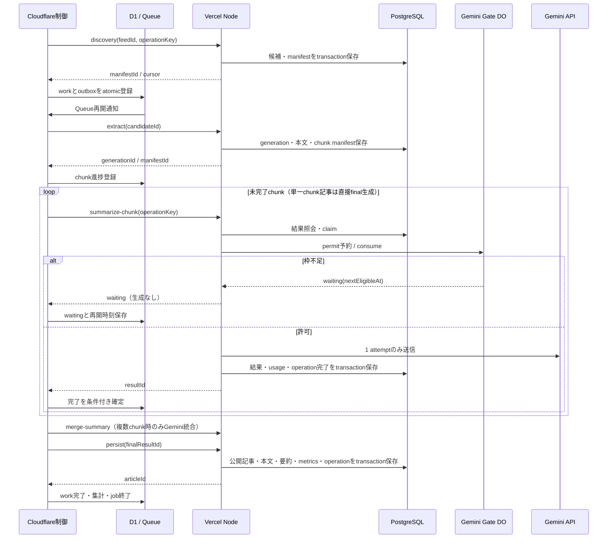

# Cloudflare管理・Vercel実行へのバッチ移行実装計画

作成日: 2026-10-10

状態: 実装着手用の計画。PoC・インフラ作成・実migration・本番切替は未実施。

## 1. 目的と採用条件

セルフホスト版Trigger.devのcollectorを、Cloudflareが実行を管理し、VercelのNode.js Functionsが処理を実行する構成へ移す。インフラ資源と設定はTerraformで管理する。記事と生成結果は既存PostgreSQL / Drizzleを維持し、記事単位の並列処理とチャンク単位の永続再開を実現する。

本書は[引き継ぎ書](cloudflare-vercel-migration-planning-handoff.md)と[構成調査](cloudflare-batch-migration-plan.md)を実装単位へ具体化する。[ADR-0008](adr/0008-cloudflare-control-vercel-execution.md)はProposedであり、現行運用は[ADR-0004](adr/0004-batch-deployment-with-trigger-dev.md)・[ADR-0005](adr/0005-local-cli-trigger-task-deployment.md)を継続する。PoC合格後、採用履歴と置き換える範囲をADRへ末尾追記する。今回の計画作成ではADRの状態を変更しない。

| 境界 | 実装する責務 |
| --- | --- |
| Cloudflare Worker / Workflows / Queues | Cron、起動、順序、待機、配送、進捗、再実行、照合 |
| Cloudflare D1 | job/work/chunk/outbox、attempt・lease・エラー・保持期限 |
| Cloudflare SQLite Durable Objects | 全体の実行枠、Google project共有のGemini送信予算 |
| Vercel Node.js Functions | discovery、本文抽出・分割、prompt作成、Gemini送信、Zod検証、PG保存 |
| PostgreSQL | 候補・本文・chunk payload・operation・生成結果・公開記事 |
| Terraform / CI | 資源・binding・Cron・project設定、環境分離、コードdeploy、migration、secret注入 |

Web改修、記事DBのD1移行、Hyperdrive、Cloudflare Containers、Vercel Cron/Workflows、Inngest、Trigger.dev Cloud、Cloud Run Jobs、新しいsystemd timerは範囲外とする。Webには最終保存の互換性を確認する。

無料枠は目標であり、保証ではない。採用条件は、用途が利用条件に合致し、実クォータとaccount共有残量を満たし、代表負荷と障害時負荷が収まり、切り戻しまで検証できること。条件未達なら件数・長文上限・頻度を減らす案と費用案を示し、採用を保留する。有料化を自動選択しない。

## 2. 現行実装と変更の優先順位

コード確認の対象は `apps/collector/src/{execute-collector,run-collector,feeds,content,summarizer,gemini-rate-limiter,persistence,config}.ts`、`packages/db/src/{schema,client}.ts`、`infra`、既存release workflows。

- `runCollector()` はfeedを逐次処理し、feed内は `p-limit`。既定記事並列2、feed候補20、分割12,000文字。HN item取得の `Promise.all` にも個別の並列上限を追加する。
- Geminiの通常・chunk・統合・fallback・429再試行は同じ送信関数を通るが、RPMは1プロセス内だけで共有する。新しいVercel実行経路ではローカル待機を分散gateとCloudflare待機へ置き換える。
- `saveArticle()` は記事を要約済みにしてから本文・要約・metricsを別々に保存する。全保存をtransactionへ入れ、成功状態の公開を最後に行う。`markArticleFailed()` は成功済みを変更しない条件付き更新にする。
- 正規化URLのuniqueだけではLLMの重複送信を防げない。article generationとoperation claimを導入する。
- `crawl_jobs.status` はrunning/succeeded/failedの3値。Cloudflare側のpartial/waitingを既存enumへ追加せず、終了時に互換集計をPGへ投影する。
- Trigger入口、Dockerfile、deploy scriptは切り戻し期間中保持する。旧プロセスと新基盤の同時本番実行は認めない。

最初に保存の原子性と成功保護を現行Triggerにも適用し、その後にstage分割と新基盤を導入する。

## 3. 配置とbuild方針

以下は新規作成する予定のpath。現在存在する実装やコマンドとは区別する。

| path | 内容 |
| --- | --- |
| `packages/domain/src/batch/{contracts,operation-key,state-machine,error-policy}.ts` | version付きZod契約、key、遷移、失敗分類。Node/CF共通の純粋処理 |
| `packages/db/src/collector/{schema,operations,payloads,results}.ts` | PG追加schemaとrepository。既存schemaへexport |
| `packages/db/src/control/{schema,queries}.ts`、`packages/db/d1/` | D1 SQLite schema・SQL・番号付きmigration。PG migrationと分離 |
| `apps/collector/src/stages/` | discovery/extract/summarize-chunk/merge-summary/persistのtestable service |
| `apps/collector/src/http/{auth,handler,deadline}.ts` | 署名、入力検証、deadline、sanitized error |
| `apps/collector/api/v1/` | Vercelの薄いNode Functions adapter、stage handlersと参照照会 |
| `apps/collector/src/control/` | Worker entry、Cron、Queue、Workflow、outbox、reconciler、gate・capacity DO |
| `apps/collector/vercel.json`、`vercel.tsconfig.json`、`control.tsconfig.json` | NodeとWorkersのbuild/typecheck分離 |
| `apps/collector/vitest.control.config.ts` | workerd runtime用のテストproject |
| `infra/modules/{cloudflare-collector,vercel-collector}/` | collector専用資源 |
| `infra/environments/collector-{staging,production}/` | 環境別root/state |
| `.github/workflows/{terraform-collector,release-collector}.yml` | 新基盤CI。既存Web releaseを変更せずDB migrationの排他を共有 |
| `docs/cloudflare-vercel-collector-runbook.md` | 実装時に作る永続運用・復旧手順 |

VercelはRoot Directoryを `apps/collector` とする独立project、Node 24、framework未指定のNode Functionsを第一案にする。workspace rootからfrozen installし、domain/dbのTS exportをbundleへ含める。`api/v1/*.ts` は `src/stages` を呼び、Trigger SDKとCF runtimeをimportしない。PoCでjsdom/Readability、Gemini SDK、workspace参照、Node 24、Fluid computeと最大300秒設定、bundleサイズを確認する。build成立を確認するまで配置を確定済みとは扱わない。

既存collector tsconfigは `src/**/*.ts` を含むため、そのままCF専用importを追加しない。Node・Trigger・CFのinclude/excludeとproject referencesを分ける。domainのbatch用subpathとDBのPG/control用subpathを追加し、Workerへ `pg` やNode専用URL正規化依存を混入させない。Cloudflareでは本文解析・大きなprompt hash計算を行わない。

Production branchは既存アプリと同じ `release`、stagingは `test` を第一案とする。collectorは両branchのGit自動deployを無効化し、検証・migration後のCI deployに一本化する。infraは `release-infra`。bundleのcommit/hash、API version、deployment IDをrelease manifestへ記録し、別branchのコードを暗黙に混ぜない。

## 4. 起動・状態・配送

### 通常フロー



### 状態と正となるデータ

PGは入力・生成結果・公開記事の正、D1は順序・進捗・配送・再開時刻の正、DOはcapacity/quotaの正とする。PGとD1に分散transactionはない。必ず「PG commit → 参照ID返却 → D1確定」の順序とし、通知を受ける前にD1を成功へ進めない。

work/chunkは `pending → running → succeeded`、runningから `waiting` または `failed`、waitingからpendingへ移る。`succeeded/failed/cancelled` はterminal。failedの手動再開は新しいresume generationを作り、成功resultを再利用する。jobは `discovering/running/waiting/succeeded/partial_failed/failed/cancelled`。全feed取得不能・認証/config不備・DB不能はjobのfatal、単一記事/feed障害は局所失敗で他を継続する。

`lease_owner`、単調増加 `lease_epoch`、`lease_until`、`state_version` のCASでclaim・遷移・完了を制御する。lease時間は暫定360秒、handler開始時にclaimする。CF timeoutで即stealせずoperation-statusを先に照会する。PGは自身のclaim epochを比較し、D1はCF work epochを比較する。両者のepochを同一のlockと解釈しない。

Queueはwork IDとresume generationのみを配送する。consumerの同時数は受信並列であり、記事/段階の実行枠とは別。capacity DOでfeed枠・記事stage枠・Gemini in-flight枠をatomic取得し、枠なしならD1へ待機とoutboxを保存する。

- ackはstable Workflow IDでinstance作成を確認し、D1へinstance IDを保存した後。既存instanceの一致確認でもack可。失敗はretryし、最大5配送（暫定）後DLQへ送る。
- outboxはwork変更と同じD1 atomic batchで作成。send後にsentを更新し、send成功後の応答喪失は再送する。consumerとD1のunique/CASで重複を吸収する。
- instance IDは環境・work ID・resume generationから100文字以内のhash形式で固定。同じworkの再配送で別instanceを作らない。
- RPD待機や長いquota待機はcapacity枠を解放。Vercelも待たず応答する。短い待機はWorkflow sleep、長い待機/予算逼迫はD1 next-runとoutboxによる新resumeへ引き継ぐ。
- Workflow外部request数を最大40、step数を最大800とする内部上限案を設け、残りをD1へ保存してcheckpoint終了する。再開generationの採番もCAS。単一記事の長文はchunk子Workflowへ分離するが、子workflow増加で日次予算が減るわけではない。
- backlog上限は暫定1日分、最大待機48時間、処理deadline72時間。越えると新規discoveryを抑え、既存workの回復を優先する。Queue/DLQ保持期間に依存せずD1から再配送する。

無料WorkflowsはCPU 10ms/step、1,024 steps/instance、外部subrequest 50、完了保持3日。公式資料にはsubrequestのinstance表記とinvocation説明が併存するため、上記40はinstance全体を対象とする保守的な上限としてPoCで再開時の計数を確認する。[公式制限](https://developers.cloudflare.com/workflows/reference/limits/)

## 5. API・冪等性・認証・deadline

### version付き契約

全APIは `/api/v1`。domainにstrictなZod schemaとdiscriminated unionを置く。全stage POSTは `apiVersion, environment, jobId, workId, operationKey, executorVersion, configVersion, deadlineAt` を持ち、stage固有参照のみ追加する。モデル/promptは固定config versionから解決し、HTTPで任意モデルや任意URLを指定できない。

| API | 入力参照 | 成功応答 |
| --- | --- | --- |
| `POST /discovery` | feedId、scheduledAt、maxItems | discoveryId、manifestId、candidateCount |
| `GET /manifests` | manifestId、cursor、limit | candidateId/処理対象区分 または chunkId/index/inputHash、nextCursor |
| `POST /extract` | candidateId、generationId | contentId、chunkManifestId、chunkCount、inputHash |
| `POST /summarize-chunk` | generationId、chunkId、modelTier、apiAttempt | resultId、effectiveModel、usage参照 |
| `POST /merge-summary` | generationId、orderedResultManifestId、modelTier、apiAttempt | finalResultId、schemaVersion |
| `POST /persist` | generationId、finalResultId、feedJobId | articleId、published / alreadyPublished |
| `GET /operation-status` | operationKey | not_found / running(leaseUntil) / waiting(nextEligibleAt) / succeeded(resultId) / failed(errorCode) / uncertain |
| `POST /job-finalize` | jobId、countVersion、集計 | crawlJobId、投影version |
| CF `POST /v1/gate/{reserve,consume,report}` | operationKey、apiAttempt、model、inputToken数、permitId等 | permit / waiting、consume許可、report受領 |

manifestは不変snapshotのkeyset cursorで50件/ページ、応答最大32KiB、制御request最大16KiBを暫定値とする。本文・prompt・生成結果・feed候補の大きいJSONは返さない。上限超過はpage縮小または拒否し、全manifestをWorkflow stateに蓄積しない。cursorはmanifest/environmentに結びつける。

共通応答は `succeeded`、`waiting(reason,nextEligibleAt)`、`running(leaseUntil)`、`failed(errorCode,retryable)`。認証は401/403、契約不正400、keyと入力の不一致409。quota待機はHTTP 200のwaitingとし、プラットフォームのHTTP 429と区別する。CFは400/401/403を自動retryしない。429/5xx/network timeoutは結果照会後に追加2回までretryする（暫定、backoff 5秒/30秒+jitter）。Workflow組み込みretryとの二重計数を避け、stageごとの累積回数をD1へ永続化する。Gemini送信成否が不明ならこのHTTP retry設定で自動再送せずuncertainへ移す。

### operationとclaim

operationKeyは `environment + stage + logicalEntityId + inputHash + model + promptVersion + schemaVersion` のcanonical hash。discoveryのentityはfeedとschedule slot、extractはgeneration、chunkはgeneration/chunk、mergeはordered result hash、persistはgeneration/final result。モデルfallbackは別operation、HTTP再送は同一operationで新request ID/nonceとする。

正規化URL単位のarticle generation claimをPGで取ってからextractする。別feed/jobでも同じ未完了generationにjoinし、単にjob IDを変えて二重生成しない。要約済みならmetrics更新だけを行う。本文改訂・prompt更新による再生成は明示的な新generationとし、通常discoveryでは既存成功記事を再生成しない。

結果再利用には入力hash・モデル・prompt/schema versionの一致が必要。claimと成功commitは短いDB transaction、Gemini通信中にDB transactionを開かない。HTTP request ID、認証nonce、operationKey、LLM apiAttempt、permit IDは別々の識別子である。quota待機/期限切れによる予約更新にはreservation generationを使い、実送信していない予約更新をLLM失敗retryとして数えない。consume後に送信成否が不明になったapiAttemptは再利用しない。

### 双方向認証

方向別・環境別のHMAC-SHA256鍵を使う。署名対象はversion、method、pathとcanonical query、raw body SHA-256、request ID、nonce、issuedAt、expiresAt、environment、key ID、executorVersion。TLS前提、期限は暫定60秒、時計差許容5秒、constant-time比較、bodyのサイズ検査を先に行う。再送は同じoperationでも新nonceで署名する。

nonceは受信先でunique insertし有効期限+時計差まで保持する。Vercel側はPG、CF側はD1。重複nonceは実処理を再実行しない。許可stage、環境、deployment、本文hashを照合し、参照IDの所属もDBで確認する。取得先は登録feed由来のcandidateに限定し、本文fetchはHTTPS、private/loopback/link-local拒否、redirectごとの再検査、件数/byte上限を設ける。

rotationは旧新2 key ID受理 → 新deploymentとCF送信key切替 → 進行中旧deployment drain → 旧key撤去。旧deploymentからのgate要求も保持期間中認証する。Vercel deployment protectionがある場合はautomation bypassを別secretで設定し、HMAC認証を省略しない。[Vercel公式手順](https://vercel.com/docs/deployment-protection/methods-to-bypass-deployment-protection/protection-bypass-automation)

### deadlineの暫定値

| 対象 | 上限案 | 処理 |
| --- | ---: | --- |
| feed/article fetch | 20秒/要求 | Abort、redirect/response byte制限。HN item並列4 |
| token計測・gate | 10秒/要求 | 失敗ならGemini送信禁止 |
| Gemini generate | 180秒 | SDK対応Abort/timeout、隠れた自動retryを無効化 |
| PG | 接続10秒、statement15秒 | 残りdeadlineで短縮、transaction rollback |
| Vercel handler | 240秒 | 保存用余裕を確保、応答後background処理なし |
| CF HTTP / Workflow step | 260秒 / 280秒 | timeout後にstatus照会、即再送しない |
| operation lease | 360秒 | 原所有者だけが期限内commit可 |

[公式Function duration](https://vercel.com/docs/functions/configuring-functions/duration)をPoC対象projectのFluid compute設定と照合する。Abortは相手側停止を保証しない。SDKがキャンセル非対応ならPromise raceだけを停止と扱わず、lease/uncertainで回復する。CPUで占有する本文抽出はbyte/文字上限を設け、240秒以内に収まる入力を実測する。

## 6. PG / D1 schemaと回復

### PostgreSQLの追加テーブル案

| table | 主なcolumn / 制約 |
| --- | --- |
| `collector_discoveries` | id、feed/job、schedule slot、executor/config version、manifest hash。環境/feed/slot unique |
| `collector_candidates` | id、discoveryId、normalizedUrl、feed metadata/fallback、articleId、処理区分。discovery/URL unique |
| `collector_generations` | id、articleId、inputHash、prompt/schema/config version、status、owner/epoch/until。articleのactive generationはpartial unique |
| `collector_payloads` | contentId、generationId、contentText/Html、extraction status、contentHash、chunkerVersion |
| `collector_chunks` | id、generationId、index、payload、inputHash、token estimate/count version。generation/index unique |
| `collector_operations` | key unique、stage/entity/input hash、model/version、status、owner/epoch/until、apiAttempt、resultId、nextEligibleAt、errorCode、timestamps |
| `collector_results` | id、operationKey unique、validated JSON/text、usage、effectiveModel、outputHash、createdAt |
| `collector_api_attempts` | operationKey/attempt unique、permitId unique、reservedTokens、sentAt、finishedAt、status、usage/errorCode |
| `collector_auth_nonces` | direction/keyId/nonce unique、expiresAt index |
| `collector_job_projections` | CF jobId unique、crawlJobId、countVersion、counts、sanitized error |

既存 `articles/article_contents/article_summaries/article_metrics` は公開用を維持する。stage途中の本文はpayload tableへ置き、旧記事を途中状態で上書きしない。persistはarticle rowをlockし、generation所有権・結果versionを検査し、4テーブルとoperation成功を一括commitする。既存成功を別generation/古いownerが置き換える操作は拒否する。

claimのUPDATEはstatus・epoch・期限を条件にしてRETURNINGで判定する。failure更新は `summary_status != summarized` かつ対応generationだけ。rollback debug transactionでは入れ子transactionの扱いをテストし、ネットワークをtransactionへ入れない。既存不完全記事はread-only整合性queryで列挙し、欠損を確認した記事のみ計画的に修復する。全成功記事を一括pendingへ戻さない。

### D1の制御テーブル案

| table | 主なcolumn / index |
| --- | --- |
| `jobs` / `feed_work` | schedule slot unique、deployment/API/config version、status、PG job参照、counts、error、deadline |
| `article_work` | workId、article/generation/candidate参照、currentStage、status、lease owner/epoch/until、stateVersion、nextRunAt、attempt、error |
| `job_articles` | job/work unique、outcome。複数feedからjoinした記事の集計を分離 |
| `chunk_work` | generation/chunk/model/prompt unique、status、resultId、operationKey、attempt、nextRunAt |
| `outbox` | work/resume/event unique、payload参照、sentAt、sendAttempt、nextRunAt |
| `workflow_runs` | stable instance ID unique、work/resume generation、executorVersion、step/subrequest budget、checkpoint |
| `auth_nonces` / `control_settings` | expiry index、mode(active/drain/paused)、config version |

due検索は `(status,next_run_at,id)`、期限回収は `(status,lease_until,id)`、outboxは `(sent_at,next_run_at,id)` にindex。集計はjob_articlesからterminal件数を再計算し、通知ごとに加算しない。D1ではinteractive transactionを前提にせず、条件付きSQLとatomic batchでoutbox/状態を更新する。cross-store失敗はreconcilerで回復する。

### 障害別の回復

| 障害 | 回復と残る限界 |
| --- | --- |
| PG成功後に応答喪失 / D1失敗 | operation-statusからresultIdを取得しD1をCAS確定。Gemini再送なし |
| Vercel timeout、PG operationはrunning | lease満了まで照会して待つ。CF capacity leaseも回収前に照合 |
| lease切れ後の遅延commit | 古いepoch/期限の書込み拒否。新ownerの成功を失敗へ戻さない |
| Gemini成功、PG保存前にcrash | attemptをuncertainへ。結果照会でも回復不能なら、自動即再送せず上限付き再生成か手動判断。課金一回保証は不可 |
| gate予約成功、送信前にcrash | 未送信予約も安全側に消費。permitを再利用せずstatus照会 |
| outbox送信成功、sent更新失敗 | 同一resume再送。stable Workflow IDで重複抑制 |
| Queue/DLQ expiry、Workflow完了保持切れ | D1の非terminal workから新resumeを生成し、PG結果を再利用 |
| D1/DO障害 | 新規送信fail closed。復旧後にlease/quota/進捗を照合 |

reconcilerは暫定5分周期、100件/ページ・実行budget付きで期限切れlease、未確定operation、outbox滞留、Workflow消失、PG集計未投影を回収する。照会できない間は成功/失敗を推定しない。schedule watchdogは予定slot欠落を検出し、同じslot IDで補完する。

### migrationと保持

PGは次の番号のDrizzle migrationを生成し、既存0000〜0003とjournalを保存する。新規table/defaultのみのadditive変更にし、旧Trigger・Webで読み書きできることを先に確認する。migrationは専用CIから1回、Session pooler/Direct（ADR-0007）、runtimeはVercel Transaction pooler + TLS/CA。`DATABASE_POOL_MAX=2`から開始し、全instanceの総接続数で上限を確認する。

D1 migrationは `packages/db/d1/` へ別履歴、stagingからproductionへ同順序で適用。runtime起動時にschema migrationしない。DB操作のCI排他はWeb releaseとcollector releaseで同じPG環境lockを使う。application rollback時に追加tableをdropしない。

保持は暫定、D1 terminal履歴30日、未完了workは削除禁止、PG中間payload/resultはterminalから7日、operation key/outcome tombstoneは90日、公開記事は既存方針。最大retry/切り戻し期間内に参照先が消えないことを検証し、cleanupは参照check付きbounded delete。バックアップ/復元と手動再実行可能期間をrunbookで明示する。

## 7. 分散Gemini gate

Googleの制限はAPI keyではなくproject単位で、入力TPM/RPM/RPD、RPDは太平洋時間0時リセットである。AI Studioの実モデル/実クォータをconfigへ登録し、夏時間込み `America/Los_Angeles` の日次境界をテストする。[Gemini公式制限](https://ai.google.dev/gemini-api/docs/rate-limits)

DO IDはGoogle projectの非secret IDから作り、同projectの全環境/呼出元を集約する。stagingを別projectにできなければ、環境別sub-budgetも同じDOで管理する。別サービスがgateを使わない場合は、観測した外部usageを差し引く固定予算で運用し、厳密な共有保証はしない。

1. Vercelはoperation結果を照会してclaim後、完全なprompt（system/schemaを含む）の入力tokenを計測する。第一案は `countTokens` をモデル/入力hashごとに保存する。countTokens自体のquota・latency・費用・追加API数をPoCで確認し、その呼出にも専用予算を置く。[token計測](https://ai.google.dev/gemini-api/docs/tokens)
2. DO内SQLite transactionでモデル別またはquota group別の60秒移動窓RPM/入力TPM、RPD、in-flightを同時判定・予約する。group内で通常と重要モデルが同じquotaを共有する場合は合算する。
3. `reserve(operationKey,apiAttempt,reservationGeneration,model,tokenBudget)` は冪等。permitは暫定5秒有効、consumeは1回のみ。consumeをDOで確定してから即送信し、Vercelの自動retryは禁止する。
4. permit発行から送信までの遅延とclock skewを含む窓（暫定60秒+最大送信遅延+安全余裕）で予約を保持する。送信の絶対一回性は保証できない。期限切れpermitは送らず、重複consumeでは再送しない。失われた予約を安易に返却しない。
5. 入力budgetは暫定 `ceil(countTokens × 1.1)`。実usage超過は差分加算、誤差警告とcooldown。過小見積もりを検出したら次送信を止め倍率/分割を修正する。計測失敗時は文字数推定で黙って送らずwaiting/failed。入力がTPM安全上限より大きい場合はNodeで再分割し、新manifest/hashを作る。
6. 429はDOへsanitized reportし、quota group共有cooldownを `max(existing, Retry-After または backoff+jitter)` で延長する。RPD判明なら次日まで保留。原因不明は短期cooldownとする。
7. 通常・chunk・merge・fallback・retryの各generateに新apiAttemptとpermitが必要。429の追加retryは既定2回を維持し、waitingはattemptへ数えない。非429のモデル失敗は重要→通常へのfallbackを1回だけ別operationで実行する。長文の成功chunkは保持し、失敗chunkと統合だけを必要に応じて通常モデルへ切替える。混在モデルの統合品質はstagingで確認する。
8. 不正JSON/Zod不合格はそのresultを公開せずterminal失敗とする。自動修復promptを無制限に送らない。network/5xxで送信成否不明はuncertain扱いでstatus確認を優先する。

DO内でGemini完了を待たず、gateは短いreserve/consume/reportだけ。token count、usage、permit、時刻、quota versionをattempt recordへ保存する。countTokensとgenerateの差やgate外利用があるため、厳密TPM保証・429ゼロ・課金完全一回性は主張しない。

## 8. Terraform・secret・deploy

固定providerはCloudflare 5.24.0 / Vercel 5.14.0、Terraform 1.11.4。取得した固定tagの公式schemaでWorker binding/migration、Workflow、Queue consumer、Vercel projectを確認した。Queue consumerは固定tagでもimport非対応と明記されており、新規作成を前提とする。実動とsecret保持はまだ未検証。

- [Cloudflare 5.24.0 Worker schema](https://github.com/cloudflare/terraform-provider-cloudflare/blob/v5.24.0/docs/resources/workers_script.md)
- [Workflow schema](https://github.com/cloudflare/terraform-provider-cloudflare/blob/v5.24.0/docs/resources/workflow.md) / [Queue consumer schema](https://github.com/cloudflare/terraform-provider-cloudflare/blob/v5.24.0/docs/resources/queue_consumer.md)
- [Vercel 5.14.0 project schema](https://github.com/vercel/terraform-provider-vercel/blob/v5.14.0/docs/resources/project.md)

| 所有者 | 資源/設定 |
| --- | --- |
| collector CF module | `cloudflare_workers_script`、`cloudflare_workers_cron_trigger`、`cloudflare_workflow`、`cloudflare_queue`（work/DLQ）、`cloudflare_queue_consumer`、`cloudflare_d1_database`。DO class/binding/SQLite migrationはWorker設定 |
| collector Vercel module | `vercel_project`、必要なcollector専用domain association。Web projectは参照・変更しない |
| CI | Worker bundle、Vercel code deployment、PG/D1 migration、runtime secret注入、release manifest |
| runtime | DO/D1の業務state、Workflow instances、Queue messages。Terraform resourceにしない |

root/state keyは `upto/collector/staging.tfstate` と `upto/collector/production.tfstate` を第一案とし、既存Web stateを維持する。R2 backend bucketは既存別repositoryの所有、作成・削除しない。lockfile/providerは新rootへ固定し、必要なupgradeだけ独立PRでplanをレビューする。D1/永続Worker namespaceはprevent_destroyと復元手順を設け、class renameやSQLite migration tagの再利用を避ける。

secret値をTerraform resource/environment variableへ渡さない。CF署名鍵、Vercel署名鍵、Gemini key、DB URL/CA、bypass tokenはCIから各サービスsecret storeへ注入する。`sensitive`だけではstate漏洩を防げない。Worker再applyで外部注入secretが消えないことをPoCで確認し、固定schemaの `keep_bindings` でsecret bindingを保持する第一案とし、read-backされた値がstateに混入しないことも確認する。差分無視だけで値の非保存を保証しない。保持できないならCronを有効化せずdeploy方式を再設計する。

### GitHub ActionsのPlan / Applyを必須にする

collectorの資源作成・変更・Workerコード反映・Cron有効化はGitHub Actionsで行う。ローカルはテスト、bundle、Terraformのoffline検証までを通常経路とし、ローカルapplyを運用手順にしない。詳細は[ローカル品質保証・Actions設計](cloudflare-vercel-local-quality-plan.md)に従う。

- credentialなしのPR検証で全ローカルテストとbuild、Terraform validate/testを必須checkにする。失敗・未実行ならPlan / Applyへ進めない。
- 同一repositoryのレビュー対象PRのみ、環境承認後に参考Planを実行する。forkにはsecretを渡さない。PR PlanはApplyへ流用しない。
- `release-infra`の確定commitでbundleを固定して `plan -out=tfplan` を実行する。差分・commit・環境・bundle hashを確認後、別のEnvironment承認を経て同じ保存PlanをApplyする。Applyで再計画しない。
- state変更でPlanがstaleになった場合は失敗させ、再Planと再承認を必要とする。state key単位のconcurrencyとR2 lockを併用し、Webとはstateを分離する。
- 現行 `.github/workflows/terraform.yml` は保存Planを使わずApply時に再計画する。これは現行実装の説明であり、新collectorの完了条件ではない。PR 4で保存Planと承認のテストを追加する。

### Actionsトークン更新は初回Applyの前提

**ユーザー申告として、現在Actionsで利用するトークンには新規リソース作成の権限が不足している。初回Plan / Apply前にトークンの権限更新・再発行とGitHub Environment Secretsの差し替えが必要。未更新のままbootstrap完了としない。** 現行Web向けのZone Read / DNS EditだけではWorker、D1、Queue、Workflow等の作成を賄えない。実トークンの権限は本計画作成では照会していない。

collector専用のCloudflare account権限、Vercel project作成・deploy権限、R2 state/lock権限を分けて棚卸しする。正確なpermission名と固定providerのAPI対応は[品質保証計画の権限表](cloudflare-vercel-local-quality-plan.md#actionsで使うトークンの更新)で管理する。Plan成功やtoken verify成功だけで作成権限を保証しない。stagingの承認済みApplyで作成と再Applyを確認し、成功後に旧tokenを失効させる。runtime署名鍵・Gemini keyのrotationとは別作業である。

### 初回bootstrap

1. 環境・権限・state key・backupを確認し、Cronなし、consumerなし、CF control mode pausedを既定にする。
2. D1、Queue/DLQ、Vercel projectを作成する。PG/D1 additive migrationを適用しruntime secretsを用意する。
3. CIでWorker/Workflow/DO classesのbundleを作り、初回Worker uploadでDO SQLite namespace migrationとbindingを作成する。Workflow resourceが既存scriptを要求する循環は、初回bootstrap用root変数でWorkflow bindingなしのuploadと登録を分け、登録後に全bindingを追加する。依存関係をPoCで確定し、常用の手動 `-target` にしない。
4. Worker secret注入・Vercel immutable deployment作成・双方向authを確認する。CFは許可deployment URL/IDを設定し、HTTPリダイレクト先へ署名を無条件転送しない。
5. Queue consumerを登録し、staging手動workを実行する。auth/schema/gate/result照会/照合/secret保持を確認する。
6. staging Cronを有効化し受入計測。本番は切替手順までCronと新規受付を無効のままにする。

通常deployはvalidate/test → bundle hash固定 → PG/D1 migration → Vercel immutable deploy → CF bundle/resource apply → secret保持確認 →互換性確認→新workのexecutor version切替。進行中workは開始時のexecutor URL/API/prompt/config versionを保持する。旧Vercel deploymentとCF旧Workflow classは非terminal参照が消えるまで保持する。Workflowのstep名/順序の破壊的変更はversion別classで移行し、replay検証なしに上書きしない。

CFコードはTerraformからdeployし、Wranglerはbundle・local test・D1 migration等に限定する。同一Workerのbindings/CronをWrangler deployと二重管理しない。新CIのpathsに `apps/collector/**`、`packages/domain/**`、`packages/db/**`、lock/workspace/build設定を含め、コードだけの更新もbundle applyへ届かせる。CF applyは `release-infra` とenvironment承認に合わせ、実装commitのartifactを明示指定する。fork PRにsecretを渡さず、review済みcommit/artifactだけをdeployする。

## 9. PR分割・TDD・検証

依存関係は `0 → 1 → 2`、`1 → 3`、`0 → 4`、`1+2+4 → 5`、`1+3+4+5 → 6`、`2〜6 → 7`。gateとの統合前にVercelのGemini endpointを有効化しない。

| PR | ファイル責務 | 最初に書くテスト / 受入条件 | 目安 |
| --- | --- | --- | ---: |
| 0 PoCと採用記録 | 隔離したbuild/auth/gate/provider検証、証拠を `docs/review-evidence/collector-migration/`、ADR採用履歴 | Node bundle、CF CPU、countTokens、期限/lease、secret保持、bootstrap依存、実account枠。採用値/未達を記録 | 2〜3日 |
| 1 共通契約 | `packages/domain/src/batch/` とexports | 各stageのinvalid入力、参照境界、key安定性、version不一致、遷移、retry分類。WorkerへNode依存が入らない | 1日 |
| 2 PG整備 | `packages/db/src/collector/`、Drizzle migration、既存 `persistence.ts` | 同時claim、各保存点のrollback、成功保護、古いowner拒否、generation join、旧Trigger互換。実PG transactionテスト必須 | 2〜3日 |
| 3 D1制御 | `packages/db/src/control/`、D1 migration、control repositories | CAS、重複集計、atomic outbox、期限回収、応答喪失照合、cleanup参照保護。実D1 runtimeでSQLを検証 | 1〜2日 |
| 4 IaC/CI | 新module/root、collector workflows、secret bootstrap | validate、固定schema、plan差分、再apply no-drift、secret非state、Cron無効、既存Web不変 | 2〜3日 |
| 5 Node stages | `src/stages/`、HTTP、`api/v1/`、Vercel/tsconfig/package scripts | auth/replay/環境混同、timeout、manifest paging、result再利用、HN並列上限、schema不合格、最終transaction | 2〜3日 |
| 6 CF実行/gate | `src/control/`、Worker build、runtime tests | DO再起動、同時reserve、全generate経路、cooldown/日次境界、Queue ack/再配送、Workflow checkpoint/再開、枠回収、旧version replay | 3〜4日 |
| 7 受入/切替 | runbook、監視、ADR追記、採用後のAGENTS/planner整合 | staging障害注入、実負荷/枠、drain・切り戻し演習、Web表示。コード本番移行は別の実行作業 | 2〜3日 |

合計15〜22作業日を暫定とする。staging観測の暦日、環境準備/承認、provider機能不足やPoC失敗の手戻りは別。従来の10〜18日案は上記の永続claim・分散gate・復旧検証を具体化した時点で見直す。

全機能の必須ケース・ローカル起動構成・CIゲートは[ローカル品質保証・Actions設計](cloudflare-vercel-local-quality-plan.md)を受入仕様とする。各機能PRで対応テストを同時実装し、PR 7まで未検証で積み残さない。

### 実装時のコマンド

既存で実行可能なチェックを変更層ごとに絞り、TDDで失敗ケースを先に追加する。

```sh
pnpm format:check
pnpm lint
pnpm --filter @upto/domain test
pnpm --filter @upto/domain typecheck
pnpm --filter @upto/db test
pnpm --filter @upto/db typecheck
pnpm --filter @upto/collector test
pnpm --filter @upto/collector typecheck
```

PR 4〜6で以下のscriptを新設する。現時点では未存在。PG integrationは隔離Postgres、controlは現行公式のWorkers Vitest integration（`@cloudflare/vitest-plugin`）とbuilt Workerを検証するtest harnessを採用候補にし、Vitest 5互換と必要なbindingのローカル対応をPoCで確認する。非互換なら別固定versionのcontrol専用test workspace/configへ分離し、既存Vitestを無条件downgradeしない。

```sh
pnpm --filter @upto/db test:integration
pnpm --filter @upto/collector test:control
pnpm --filter @upto/collector typecheck:control
pnpm --filter @upto/collector build:control
pnpm --filter @upto/collector build:vercel
```

`build:vercel` はCIで取得した対象project設定の `vercel build`、`build:control` はdry-run bundleのみを行うよう定義する。テストはfake clock/SDKとruntime integrationを分け、secretや実本文をfixtureへ入れない。計測用stagingの実API呼出は別jobとする。

Terraformは新rootごとに検証する。

```sh
terraform -chdir=infra fmt -check -recursive
terraform -chdir=infra/environments/collector-staging init -backend=false -lockfile=readonly
terraform -chdir=infra/environments/collector-staging validate
terraform -chdir=infra/environments/collector-production init -backend=false -lockfile=readonly
terraform -chdir=infra/environments/collector-production validate
terraform -chdir=infra/environments/collector-staging providers schema -json
```

接続可能な段階では安全にcredentialsを注入し、各rootでremote `init` と `plan`。planのWeb/DNS/backend変更・永続資源replacementは0を受入条件とする。plan/state JSONを公開artifactへ出さない。最終統合で `pnpm typecheck`、`pnpm test`、既存 `pnpm exec playwright test` を実行し、保存記事がfeedに表示されることを確認する。

Trigger互換を変更したPR 2では既存collector testsに加え `pnpm trigger:deploy:dry-run`、`sh -n apps/collector/scripts/deploy-trigger.sh`、`docker version`、`docker buildx version` を対象環境で確認する。harness更新時はAGENTS指定のexecpolicy/hookチェックを行う。今回は文書のみなのでこれらを実行済みとは記録しない。

## 10. 無料枠の計測・監視・受入

2026-10-10取得の公式資料に基づく基準。実装時に再確認し、account全体の使用量と残量を記録する。

| 対象 | 無料枠の基準 | 計測 |
| --- | --- | --- |
| Workflows | 3,000 steps/日、1GB-month storage | feed/article/chunk/resume/retry/照合込みのsteps、storage、CPU。[料金](https://developers.cloudflare.com/workflows/reference/pricing/) |
| Queues | 10,000 operations/日、保持24時間 | write/read/delete、再配送/DLQ/再投入込み。[料金](https://developers.cloudflare.com/queues/platform/pricing/) |
| DO | SQLite限定、100,000 requests/日、13,000 GB-s/日 | gate/capacity requests、duration、SQL storage/rows。[料金](https://developers.cloudflare.com/durable-objects/platform/pricing/) |
| D1 | 読取500万行/日、書込10万行/日、合計5GB | query meta、index write、cleanup、nonce込み。[料金](https://developers.cloudflare.com/d1/platform/pricing/) |
| Vercel Hobby | 4 CPU-hrs/月、360 GB-hrs/月、100万invocations/月、非商用個人利用 | Web等との共有usage、Function CPU/memory/network。用途適合を別途確認。[条件](https://vercel.com/docs/plans/hobby) |
| Gemini / PG | 契約・project・実モデル別 | generate/countTokens/fallback/uncertain再送のAPI数・token、DB connection/storage。CF/Vercel無料判定と別計上 |

負荷モデルは `日次generate = 単一chunk記事数 + Σ(複数chunk記事のchunk数+統合1) + fallback + retry`、`日次steps = discovery + 記事stage + chunk + sleep/checkpoint + outbox/照合`。公式課金stepはretryを含まないが、retryのHTTP/API数・CPU・quotaは別途数える。Vercel月間は実測1日usage×30に既存usageと障害余裕を加算する。

初期stagingはfeed並列1、article stage並列2、同一記事chunk並列1、Gemini in-flight2、1feed1候補から開始。図解の100記事/日、feed3、記事4、13秒間隔は運用値に転記しない。測定後に限り引き上げる。

受入は次を満たすこととする。

1. 代表100件（短文、長文、重複、RSS fallback、HNを含む）のfake API障害試験で、重複通知による二重公開0、成功状態の失敗への逆戻り0、成功chunk再生成0、未回収lease0。
2. 実APIは別staging DB/projectで費用上限を設定して少数から開始。7日以上かつ予定Cron 10回以上を観測し、正常取得記事の最終保存成功率99%以上、p95完了は暫定24時間以内。実測件数と除外原因を併記し、小標本の率だけで保証しない。
3. 429/RPD、timeout/遅延成功、PG commit直後の応答喪失、D1障害、DO再起動、Queue重複/24時間超保留、deploy中再開、old owner commitを注入し、上記復旧表どおり回復する。
4. 共有usage込みの通常負荷予測を枠の70%以内、障害時予測を90%以内、CF control CPUのp99を内部目標8ms未満とする。最悪入力/計測CPU例外も確認する。budget超過時の新規受付停止が作動する。
5. 要約schema、score、tags、日本語品質、既存記事feed表示を比較する。旧Trigger比較はfixture/fake Geminiで同じ入力を使い、実APIの二重比較は限定サンプルだけにする。
6. 再apply no-drift、秘密非露出、backup復元、切り戻し演習を合格させる。

監視はjob/work/operation/attempt/permit IDで追跡し、本文・prompt・URL query・Gemini生応答・署名header・secretを出さない。集計はD1に永続化し、Vercel短期ログだけに依存しない。監視項目はschedule欠落、最古work age、outbox lag、lease期限切れ、quota waiting時間/原因、実API attempts/usage/429、uncertain、DB接続、CF steps/CPU/rows、Vercel CPU/memory、失敗stage。

暫定警告は予定slotが2周期欠落、outbox lag 10分、処理deadlineの半分経過、残予算30%。残予算10%でdiscoveryを止め既存処理をdrainし、gateも上限超過を拒否する。無料枠未達なら日次候補・長文chunk数・Cron頻度・保持を削減して再計測し、許容完了時間と両立しなければ採用保留と費用見積もりを提示する。

## 11. 本番切替と切り戻し

### 切替

1. PoC/受入証拠、ADR採用追記、runbook、backup、正常旧Trigger version、secret rotation手順を揃える。productionにadditive migrationと新資源を用意し、Cronなし/control pausedで疎通だけ確認する。
2. Triggerのscheduleを無効化し、手動/retry起動も停止。queued/running runをdrainし、旧LLM送信・PG書込み・retryが残っていないことを確認する。完了を待てない場合は切替を保留する。
3. productionの新controlをactiveにし、1feed1記事の手動workを実行する。PG保存、D1完了、gate集計、Web表示、重複再実行を確認する。
4. 旧基盤停止を再確認し、新CronをTerraform設定で有効化する。TriggerのAsia/Tokyo予定をCFのUTC Cronへ明示変換し、slot/次回時刻を確認する。
5. 最初の2周期は即時監視、その後24時間・7日でusageと整合性を確認する。件数を段階的に増やし、受入budgetを維持する。
6. 旧Triggerのdeployment/secret/データは暫定14日かつ新基盤7日安定確認まで保持。非terminal workとversion参照がなくなってから旧入口撤去を別PRで行う。

### 切り戻し

1. 新Cronを無効化し、controlをdrainにしてdiscovery/Queueからの新stageを止める。gateの新permitも停止する。
2. 実行中Vercelをstatus照会し、PG commit/uncertain/lease満了を照合する。Queue consumerだけ止めてもWorkflowは動くため、Workflowも次stageを開始しない設定を確認する。
3. D1 work/outbox/Queue/DO stateを保持し、新runtimeの書込みが止まるまで旧Triggerを再開しない。止められない場合は双方pauseのまま障害対応する。
4. 既存公開成功記事を保持し、旧Triggerの正常versionを1件で実行する。D1未完了workはpausedのままなので旧Triggerの処理結果は後日照合する。
5. 旧scheduleを再開する。additive DB migrationは残し、D1/Queueをdestroyしない。新基盤再開時は旧runをdrain後、PG成功記事/operationとD1を照合して完了反映してから再配送する。

実行中のGemini結果が失われた場合は再課金の可能性を残す。application rollbackだけでその呼出を取り消せない。破壊的逆migrationや広範な記事状態リセットは本計画に含めない。

## 12. 実装前に確定する情報と記録

秘密の値を文書/chatに記録せず、接続先識別・非secret quota・測定値と証拠の場所を残す。

| 未確認情報 | 確認時期 / 決める事項 |
| --- | --- |
| 現Cron/件数/長文比率/run時間/許容遅延 | PR 0、日次予算・処理deadline・backlog上限 |
| AI Studio実モデル/RPM/入力TPM/RPD、他用途 | PR 0、quota group・shared gate・外部予算・countTokens方式 |
| Vercel plan/用途/残量、CF残量 | PR 0、無料枠採用可否・CPU余裕 |
| staging/production DB、TLS/pool到達性/backup | PR 0〜2、runtime/migration接続・接続数 |
| Terraform権限/state/secret保持/provider機能 | PR 0/4、初回upload順・固定versionでの実動 |
| 最大本文byte/chunk数、manifest byte、token誤差 | PR 0/5、入力上限・再分割・子Workflow閾値 |
| Vitest 5とCF runtime test互換 | PR 0、専用test projectのpackage/version |
| 履歴/再実行/切り戻し期間、費用目標 | PR 0/7、保持/cleanup・費用受入条件 |

PoC成果物には「確認済み」「不合格」「未確認」を明記し、暫定値を更新する。API、schema、state、PR構成は本書を起点に実装できるが、無料稼働とbootstrap成立はPoC証拠を必要とする。

実装後は本書の受入結果を残し、コード/tests/runbookが置き換えた一時handoffと検証メモを整理する。ADRと永続運用runbookを保持する。本計画作成で変更するのはこの文書だけであり、既存未commitの調査・図解・ADR追記を保持する。
