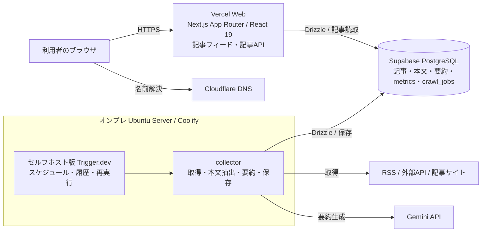
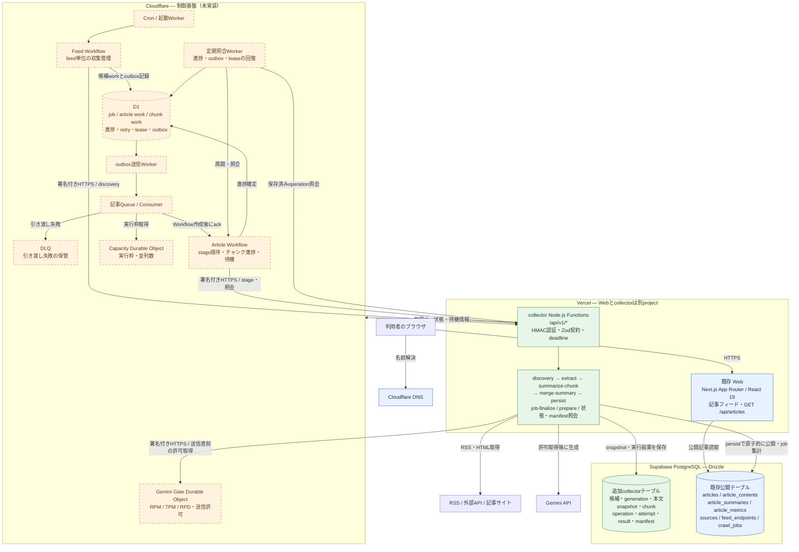
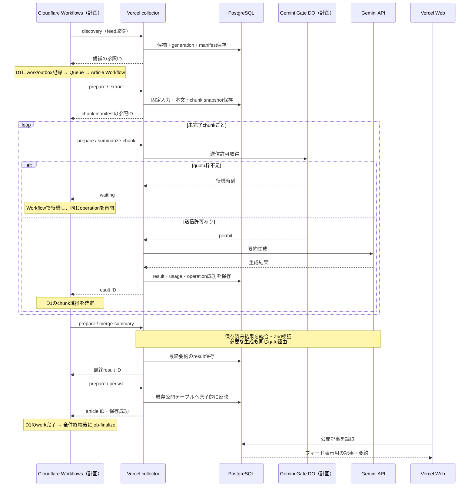

# Upto システム構成とバッチ移行アーキテクチャ

更新日: 2026-10-11

## この図の対象と実装状況

今回のマイグレーションは、オンプレのセルフホスト版Trigger.devが担っていたバッチ管理・実行を、**Cloudflareによる制御とVercelによる処理実行へ分離する移行**である。記事データは引き続きSupabase PostgreSQLに保存し、VercelのWebから表示する。

ただし、現時点は移行実装中であり、本番切替完了を表す図ではない。[ADR-0008](adr/0008-cloudflare-control-vercel-execution.md)はProposedで、現行Trigger.dev運用を継続する。以下はリポジトリ内の実装・運用文書に基づく構成であり、稼働環境への接続確認は行っていない。

| 構成要素 | 2026-10-11時点の状態 |
| --- | --- |
| Vercel Web / Supabase PostgreSQL / Cloudflare DNS | 既存構成を維持 |
| Vercel向けcollector API・各stage・認証 | ローカル実装済み。受付停止でのActions deploy経路は実装済み。実deployの受入とCloudflareとの接続は未完了 |
| PostgreSQLのcollector用テーブル・保存処理 | schema / migration / repositoryを実装済み。本番への追加migration適用は未実施 |
| Cloudflare Cron / Workflows / Queues / D1 / Durable Objects | 移行先の設計。runtimeは未実装 |
| 新collector用Terraform / CI | 両環境の停止基盤、bootstrap bundle、暗号化保存Plan/承認後Apply経路を実装。実資源・接続は未検証 |
| 旧Trigger停止・新Cron有効化 | 未実施。現bootstrap CIはconsumer/Cron有効化を拒否 |

詳細な検証状況は[collector運用手順](cloudflare-vercel-collector-runbook.md)、受入条件は[ローカル品質計画](cloudflare-vercel-local-quality-plan.md)を参照する。

## 現在の稼働構成

Cloudflare DNSは名前解決を担当する。図はCloudflareをWebへの必須HTTPプロキシとして表していない。Webはserver側からDBを読み、ブラウザへ記事を返す。

## 移行先のシステム構成

この図は**完成時の構成**を示す。青は既存構成、緑はローカル実装済み・本番未適用、破線の橙は未実装の計画部分を表す。接続線も完成時の通信であり、現時点の疎通確認を意味しない。

Cloudflareは処理の順序・進捗を管理し、CPUを使うRSS解析、jsdom/Readabilityでの本文抽出、チャンク分割、Gemini SDK呼出しはVercelで実行する。1 HTTP invocationは1 stageまたは1チャンクを処理し、結果保存まで待って応答する。

## 状態とデータの分担

| 保存先 | 保存するもの | 責務 |
| --- | --- | --- |
| D1（計画） | job/work/chunkの制御状態、retry、次回時刻、lease、参照ID、outbox、error code | 次に何を動かすかの判断と進捗の正 |
| Durable ObjectsのSQLite（計画） | 実行枠、送信許可、quota予約、cooldown | 複数Workflow / invocationで共有する並列数・API送信制御 |
| PostgreSQLの追加collectorテーブル | 取得候補、固定入力、本文・chunk、生成結果、operation、API attempt、nonce、manifest | 実処理の保存結果と冪等性の正 |
| PostgreSQLの既存公開テーブル | 記事・本文・要約・metrics、取得jobの互換集計 | Webが読む公開データ |

本文やchunk本文はD1へ送らず、PostgreSQLに置く。Cloudflareへ返すmanifestはページ分割した参照IDと少量のmetadataである。CloudflareからPostgreSQLへの直接接続やHyperdriveは、この構成に含めない。

`persist`は記事・本文・要約・metricsとoperation結果、generation完了を同じtransactionで確定する。D1とPostgreSQLには分散transactionがないため、PostgreSQLへの保存後にD1の進捗を確定し、応答喪失は保存済みoperation照会と定期照合で回復する。

## 記事1件の処理フロー

以下もCloudflare側の完成を前提としたフローである。

成功済みoperationは再配送時にも保存済み結果を再利用する。generation / operationのleaseとepochで古い実行者からの更新を拒否する。Gemini送信後に結果が不明になったものは`uncertain`として自動再送を止める。外部APIの課金まで完全な一回保証とはしない。

## コード配置とインフラ管理

| 配置 | 担当 |
| --- | --- |
| `apps/web` | Next.js UI・記事API・公開記事読取 |
| `apps/collector/api/v1` | Vercel向け9 API入口 |
| `apps/collector/src/http` | 共通HTTP handler、認証、runtime接続、gate client、安全な外部取得 |
| `apps/collector/src/stages` | discovery / extract / summarize-chunk / merge-summary / persist / job-finalize |
| `apps/collector/src/trigger` | 切替まで維持する既存Trigger.dev入口 |
| `packages/domain/src/batch` | Zod契約、operation key、HMAC、状態遷移・検証などの共有ロジック |
| `packages/db/src/collector` / `packages/db/drizzle` | collector用永続化、transaction、schema / migration |
| `infra` | 現在はWeb project / domain / DNS。新collectorのCF・Vercel資源は今後拡張 |

Terraform stateは既存の外部管理Cloudflare R2 bucketに保存する。R2はTerraform state用であり、記事本文の保存先ではない。移行先ではstaging / productionのstateと資源を分離し、Cron・bindings・Workflow・Queue/DLQ・DO・D1・collector projectをTerraform管理する計画である。runtime instance、業務データ、DB migration、コードdeploymentはTerraformの管理対象と分ける。

通信はCloudflare→VercelとVercel→gateの双方向でHMAC署名を検証する。Gemini keyとDB接続情報はVercel、通信鍵は各runtimeのsecret storeに置き、Terraform stateへ秘密値を保存しない。

既存WebのreleaseはGitHub ActionsでDB migration成功後にVercelへdeployする。migration接続は[ADR-0007](adr/0007-session-pooler-release-migrations.md)のSession pooler / CA検証に従う。新collectorのCIと本番切替は未完了であり、旧Triggerをdrainしてから新Cronを有効化する受入・切り戻し手順は[移行実装計画](cloudflare-vercel-migration-implementation-plan.md)を参照する。

## 関連ドキュメント

- [ADR-0008: Cloudflareによるバッチ管理とVercelによる処理実行](adr/0008-cloudflare-control-vercel-execution.md)
- [バッチ移行計画: 責務分担と制御設計](cloudflare-batch-migration-plan.md)
- [collector運用手順: 実装・検証状況](cloudflare-vercel-collector-runbook.md)
- [Terraform / Vercel / Cloudflare運用手順](terraform-vercel-cloudflare-runbook.md)
- [Supabase接続デプロイ手順](supabase-deployment-runbook.md)

## collector Terraform実装との対応

`infra/environments/collector-{staging,production}` は既存Webと別stateを使い、Vercel project/domain/DNSとCloudflare制御資源を管理する。Worker/Workflow登録はfoundation → worker → workflows → readyの別Applyで段階化した。binding/class名は [Terraform運用手順](terraform-vercel-cloudflare-runbook.md#collector-terraform運用) に記載する。

現時点の配置コードは `infra/bootstrap/control.mjs` の停止bundleであり、上図の収集・outbox・reconciler・Gemini Gate業務処理を実装したものではない。実Plan/Applyとsecret保持PoCはActionsで別途確認し、本runtimeとmigration/deployment連携の完成後に起動する。Terraformコードの実装によりADR-0008をAcceptedへ変更しない。
